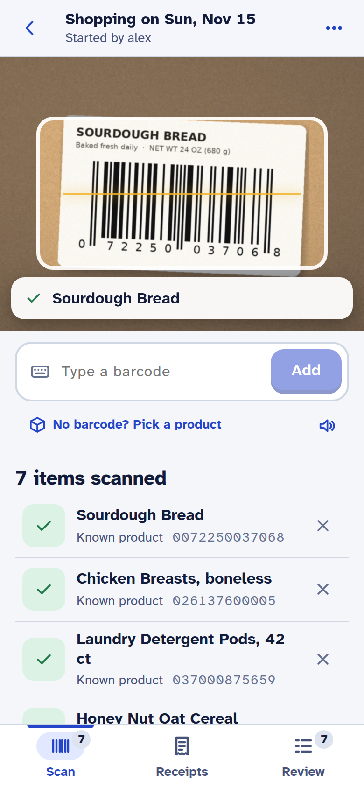
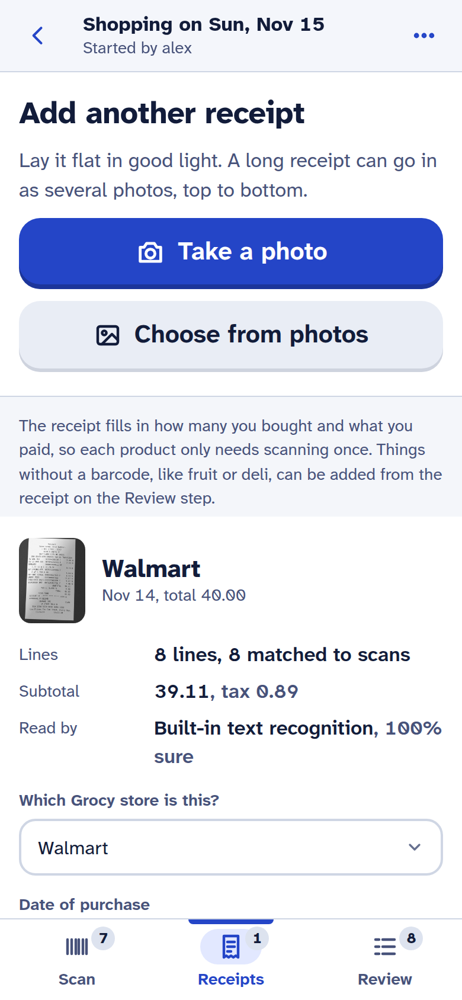
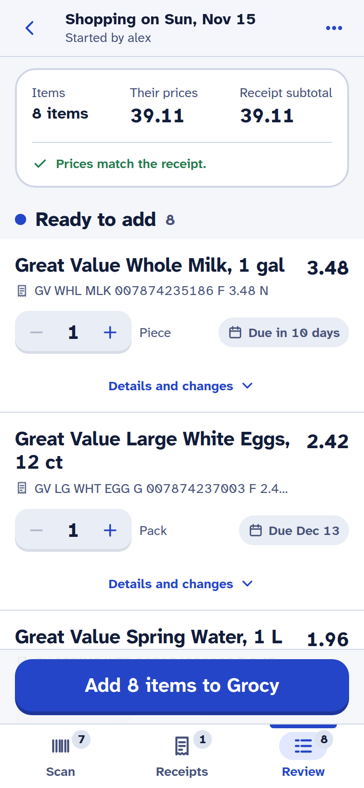
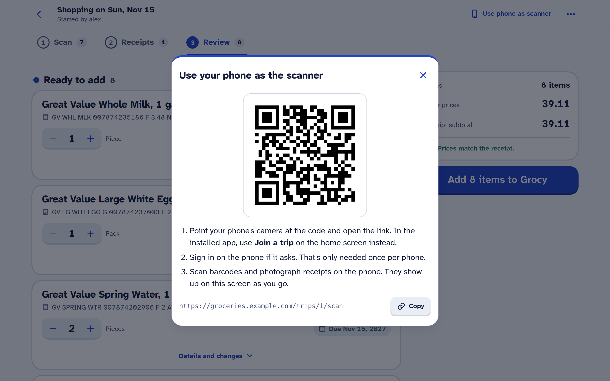

# Grocy Assistant

A self-hosted companion app for [Grocy](https://grocy.info) that takes the tedium
out of logging purchases. Instead of entering every product on Grocy's Purchase
page one at a time:

1. **Scan** the barcode of each thing you bought, once.
2. **Snap** a photo of the receipt (or several, if you went to several stores).
3. **Review** one screen and tap **Add to Grocy**.

Quantities, prices, the store and due dates are filled in from the receipt and
from each product's defaults in Grocy. It is an installable PWA, so it works in a
desktop browser and as a home-screen app on a phone.

| 1. Scan | 2. Snap the receipt | 3. Review and add |
| :---: | :---: | :---: |
|  |  |  |
| Point the camera at each barcode once. | The receipt fills in quantities, prices, the store and the date. | Check one screen, then send it all to Grocy. |

Prefer to review on a bigger screen? Open the trip on your computer and use your
phone as its scanner:

<p align="center">
  
</p>

## How it works

- **Scanning** uses the phone camera (or a USB/Bluetooth barcode scanner, or typed
  codes). Barcodes Grocy already knows resolve instantly. Unknown ones are looked up
  in the Open Food Facts family of databases, and in the review step you either
  confirm a new Grocy product with the suggested name or link the barcode to a
  product you already have. Grocycode labels (`grcy:p:…`) work too.
- **Receipts** are read on your server by a built-in OCR engine (RapidOCR, models
  bundled, no internet needed) with dedicated parsers for Walmart, Costco and the
  Kroger family (Kroger, Smith's, Fred Meyer, Ralphs, …) plus a generic fallback.
  Each read gets a confidence score, mostly based on whether the item prices add up
  to the printed subtotal.
- **Matching** pairs receipt lines with what you scanned: by the UPC printed on the
  receipt (Walmart), by what it learned on earlier trips, and by abbreviation-aware
  name matching ("GV WHL MLK" ↔ "Great Value Whole Milk"). Whatever you confirm is
  remembered per store, so the second trip needs less attention than the first.
  Receipt lines for things without a barcode (produce, deli) can be turned into
  items directly, and are recognized automatically from then on.
- **AI assist is optional.** With a provider configured (Anthropic, or any
  OpenAI-compatible endpoint such as OpenAI, OpenRouter, Ollama or LM Studio), it
  is consulted only when the built-in reader is unsure, or when you tap
  "re-read with AI". A Grocy admin can set a household default under *Settings*,
  and anyone can set their own provider and key instead, which then applies to
  their receipts. Without a provider everything still works.
- **Phone as the scanner for your computer.** Open a trip on the computer, choose
  *Use phone as scanner*, and scan the QR code it shows with your phone (the phone's
  camera app, or *Join a trip* inside the installed app). Both devices then show the
  same trip live: barcodes and receipt photos taken on the phone appear on the
  computer within a couple of seconds, where reviewing is more comfortable. Trips are
  shared by the household, so two people can also work on one trip at once.
- **Submitting** books each item through Grocy's REST API under the API key of the
  person who taps the button, so Grocy's journal shows who logged what. A submitted
  trip can be undone, which reverses its stock bookings in Grocy.
- **When Grocy is down** the app keeps working from its last copy of your products:
  scanning, editing trips and reading receipts carry on, and the trip waits until
  Grocy is back to be submitted.

### Accounts

There are none to manage: **people sign in with their Grocy username and
password.** On the first sign-in the app creates an API key for that person in
Grocy (it shows up under *Manage API keys* as "Grocy Assistant"), keeps it
encrypted, and discards the password. Whoever is an admin in Grocy is an admin
here, which only matters for the household AI settings. While someone has the
app open, it re-checks their Grocy key every few seconds, so deleting a Grocy
user signs them out on all their devices within about half a minute.

If your Grocy doesn't use its own login form (LDAP or reverse-proxy
authentication), choose *Use a Grocy API key instead* on the sign-in screen and
paste a key from Grocy's wrench menu → *Manage API keys* → *Add*.

#### Behind a single-sign-on proxy

If Grocy uses reverse-proxy authentication (`GROCY_AUTH_CLASS` set to
`Grocy\Middleware\Auth\ReverseProxyAuthMiddleware`, behind Authentik, Authelia,
oauth2-proxy or similar), the app can use the same sign-in. Put it behind the same
proxy and set both of these:

```yaml
    environment:
      # The header Grocy trusts (its GROCY_REVERSE_PROXY_AUTH_HEADER),
      # e.g. X-Authentik-Username or Remote-User.
      GA_TRUSTED_USER_HEADER: X-Authentik-Username
      # Where the proxy connects to the app from: IP addresses or networks,
      # separated by commas.
      GA_TRUSTED_PROXIES: 172.18.0.5
```

Whoever the proxy has signed in is then signed in to the app as well, with no
sign-in screen: the app passes the header on to Grocy, so Grocy decides who that is,
and gets them an API key as above. A person's existing key is reused, so signing in
on another device doesn't create another one.

The header works like a password that nobody has to know, so read this before
turning it on:

- **The header is believed only on connections from `GA_TRUSTED_PROXIES`.** From
  any other address it is ignored and the usual sign-in screen is shown. The app
  refuses to start with `GA_TRUSTED_USER_HEADER` set and `GA_TRUSTED_PROXIES`
  missing. List the proxy's own address where you can (in Compose, give the proxy a
  fixed `ipv4_address`). If you list a whole Docker network instead, every
  container on it is trusted, and you must also remove the app's `ports:` entry:
  connections to a published port can arrive from that network's own gateway
  address, which would let anyone who reaches the port sign in as anyone.
- **The proxy must replace the header**, never pass on one the browser sent. A
  request carrying the header twice is refused.
- **Give the app the same access rules as Grocy.** Everyone the proxy lets through
  to the app gets a Grocy account: Grocy creates one for any name it hasn't seen,
  and Grocy 4.7.1 makes that account an admin.
- **People are managed at the proxy.** Deleting someone in Grocy signs them out
  here, but if the proxy still lets them in, their next visit creates a new Grocy
  account. Likewise, signing out of the app only lasts until the next visit; to
  really sign out, sign out of the proxy.
- **Not using the Docker image?** Start uvicorn with `--no-proxy-headers`, as the
  image does. Otherwise the address the app checks can be one taken from
  `X-Forwarded-For` instead of the one that actually connected.

In the app, someone the proxy signed in has no *Sign out* button, and when the
proxy's own session runs out the app sends the browser to the proxy's sign-in
page and brings it back to where it was.

If the sign-in screen appears although you came through the proxy, the app's log
says which address it ignored the header from.

## Installing with Docker

You need:

- Docker with the Compose plugin, on a machine that is `linux/amd64` or
  `linux/arm64` (a Raspberry Pi 4 or 5 or an ARM NAS is fine).
- A Grocy the machine can reach (4.x; developed against 4.7).
- A way to serve the app over **HTTPS**. Phones only allow camera access over
  HTTPS, and the app itself speaks plain HTTP on port 8080, so something in front
  of it has to terminate TLS. Step 3 has ready-made options.

### 1. Create the compose file

In a new folder, save this as `docker-compose.yml`, with your own Grocy address:

```yaml
services:
  grocy-assistant:
    image: ghcr.io/sequoiap/grocy-assistant:latest
    restart: unless-stopped
    ports:
      - "8080:8080"
    volumes:
      - grocy_assistant_data:/data
    environment:
      GA_GROCY_URL: https://grocy.example.com

volumes:
  grocy_assistant_data:
```

`GA_GROCY_URL` is the one setting you must provide, and it has to be the address
of Grocy **as seen from inside the container**:

| Where Grocy runs | `GA_GROCY_URL` |
| --- | --- |
| Another machine, or behind its own domain | That address, e.g. `https://grocy.example.com` or `http://192.168.1.20:9283` |
| A container in the same compose file, or on a Docker network both share | The service name and the port it listens on inside the network, e.g. `http://grocy:80` |
| The same host, on a published port | `http://host.docker.internal:9283`, and add `extra_hosts: ["host.docker.internal:host-gateway"]` to the service. This needs Grocy's port published on all interfaces, not only on `127.0.0.1`. |

`localhost` will not work: inside the container it means the container itself.

The Grocy address is deliberately not editable from the app: people type their
Grocy password into it, so where that password is sent should only be changeable
by whoever controls the server.

### 2. Start it

```sh
docker compose up -d
docker compose logs -f grocy-assistant    # Ctrl-C to stop watching
```

The log ends with `Uvicorn running on http://0.0.0.0:8080` once it is up, and
`docker compose ps` shows the container as `healthy` within half a minute.
If `GA_GROCY_URL` is missing, the container stops with a one-line message saying
so. From a computer you can already open `http://<host>:8080` and sign in, but
scanning with a phone needs the next step.

### 3. Put HTTPS in front of it

| Setup | What to do |
| --- | --- |
| You already run a reverse proxy (nginx, Traefik, Caddy, …) | Proxy a hostname to port 8080. Allow request bodies of about 100 MB (a long receipt can be several photos in one upload); no WebSocket support is needed. |
| Caddy with automatic certificates | Use [`deploy/caddy`](deploy/caddy/docker-compose.yml) instead of the file above: it runs the app and Caddy together. |
| Private HTTPS on your tailnet | Use [`deploy/tailscale`](deploy/tailscale/docker-compose.yml) instead: the app is reachable only from your Tailscale devices. |

The Caddy and Tailscale setups need the files in those folders, so clone this
repository (or download the folder) and follow the steps in the comments at the
top of each compose file. They take `GA_GROCY_URL` from a `.env` file next to the
compose file; see [`.env.example`](.env.example).

### 4. Sign in and install it on your phone

Open the HTTPS address and sign in with your **Grocy** username and password
(see [Accounts](#accounts)). On a phone, open the same address in the browser and
choose *Add to Home Screen* (iOS: the Share menu in Safari; Android: the browser
menu) to install it as an app. Allow camera access when it asks.

### Updating and other housekeeping

- **Updating:** `docker compose pull && docker compose up -d`. An installed
  phone app offers the new version the next time it is opened.
- **Staying on one release:** change `latest` in the compose file to a version
  such as `0.1.0`, or `0.1` for the newest 0.1.x. Versions are listed under
  [Releases](https://github.com/sequoiap/grocy-assistant/releases).
- **Your data** (trips, receipt photos, what the matcher has learned) lives in
  the `grocy_assistant_data` volume, which is what to back up. Stored Grocy and
  AI keys are encrypted with a key kept in that same volume, or with
  `GA_SECRET_KEY` if you set one. If you mount a host folder at `/data` instead
  of the volume, it must be writable by user id 1000.
- **Building from source:** the compose files in this repository also carry a
  `build:` line, so in a checkout `docker compose up -d --build` builds the image
  from your working copy instead of pulling it.

### Configuration

The AI provider is set in the app under *Settings*. Everything else is an
environment variable:

| Variable | Default | Purpose |
| --- | --- | --- |
| `GA_GROCY_URL` | **required** | Address of your Grocy; the app won't start without it |
| `GA_SECRET_KEY` | generated | Encrypts stored API keys |
| `GA_DATA_DIR` | `/data` | Where the database and receipt photos live |
| `GA_OCR_CONFIDENCE_THRESHOLD` | `0.6` | Below this, the AI fallback is consulted |
| `GA_MAX_UPLOAD_MB` | `25` | Per-photo upload limit |
| `GA_SESSION_DAYS` | `90` | How long a sign-in lasts |
| `GA_TRUSTED_USER_HEADER` | unset | Header a single-sign-on proxy names the user in; see [Behind a single-sign-on proxy](#behind-a-single-sign-on-proxy) |
| `GA_TRUSTED_PROXIES` | unset | Addresses or networks that header is believed from; required with it |
| `GA_KEY_CHECK_SECONDS` | `15` | How often the Grocy key of each person using the app is re-checked (`0` turns it off) |

## Development

```sh
# backend (Python 3.12, uv)
cd backend
uv sync
GA_GROCY_URL=http://localhost:9283 uv run uvicorn app.main:app --port 8765 --reload
uv run pytest                 # add -m "not slow" to skip the tests that run real OCR
uv run ruff check app tests

# front end (see frontend/README.md)
cd frontend
npm install
npm run dev
```

`uv run python -m app.receipts photo.jpg` prints how a receipt photo was read, row
by row, which is the quickest way to see why one misparsed. API docs are at
`/api/docs`; `backend/app/schemas.py` is the contract the front end is built on.

```
backend/app/
  routers/      HTTP API (auth, settings, trips, Grocy metadata)
  services/     matching, trip resolution, receipt processing, submit/undo
  receipts/     OCR, row reconstruction, store parsers, confidence scoring
  ai/           optional providers (Anthropic, OpenAI-compatible)
  grocy/        Grocy REST client and the sign-in exchange
frontend/src/   the PWA
deploy/         Caddy and Tailscale compose examples
```

## Releasing

The version is recorded in several files; `scripts/version.py` writes all of them.

```sh
python3 scripts/version.py set 0.2.0
git commit -am "Release 0.2.0"
git push origin main          # wait for CI to pass
git tag v0.2.0
git push origin v0.2.0
```

Pushing the tag starts the [release workflow](.github/workflows/release.yml). It
stops if the tag and the version in the code disagree, runs the checks, builds
the image for amd64 and arm64, pushes it to `ghcr.io/sequoiap/grocy-assistant`
tagged `0.2.0`, `0.2` and `latest`, and creates the GitHub Release. Waiting for
CI on `main` first also makes the release quicker: it reuses the image layers
that CI run built.

A pre-release (`set 0.2.0-rc.1`, tag `v0.2.0-rc.1`) is published as `0.2.0-rc.1`
only: `0.2` and `latest` stay where they are, and the GitHub Release is marked
as a pre-release.

## Status and known limits

- The receipt parsers are tested against realistic receipt text and rendered
  receipt images, not yet against a collection of real photos from each store.
  Expect to tune them; the debug command above and the *raw text* kept with every
  receipt are there for that.
- The AI providers are covered by tests against mocked APIs only.
- The Tailscale compose example has not been run against a real tailnet.
- Signing in creates the person's API key through a page of Grocy's web interface
  rather than its documented API (which has no way to do it). It works on Grocy
  4.7; if a later Grocy changes that page, signing in with a pasted API key still
  works.
- The phone needs a connection to the app's server to scan; there is no offline
  queue on the phone. (Grocy itself being down is fine, see above.)
- A phone joining a trip signs in with a Grocy account (once; sign-ins last 90
  days). Pairing by QR code without signing in is not built yet.
- Upgrading from a version with the app's own accounts starts a fresh database;
  the old one is kept next to it as `grocy-assistant.db.pre-grocy-login.bak`.
- Items sold by weight are booked as quantity 1 unless the product's stock unit in
  Grocy is that weight unit (lb, kg, …), in which case the weight is used.
